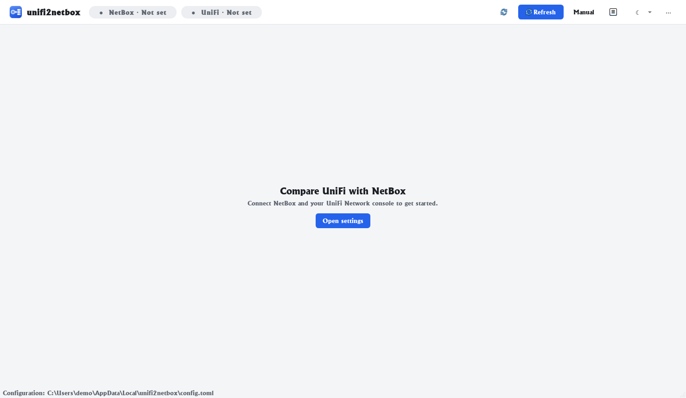
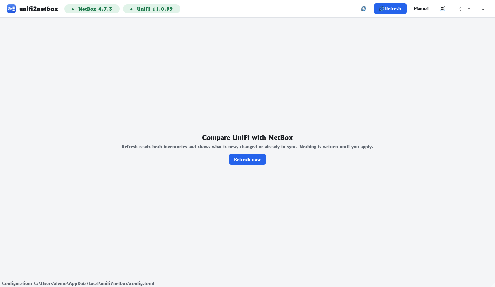

# First start

On the very first start the app opens **Settings**, because no connection is
configured yet. If you close it, the window shows **Open settings**.

## Enter the connections

1. On the **NetBox** page enter the base URL (for example
   `https://netbox.example.com`, without `/api`) and an API token.
2. On the **UniFi Network** page enter the console URL and a local API key.
   If the key can see several sites, choose the site.
3. On **Sync defaults** choose the **NetBox site for UniFi devices** and a
   **default device role** for new devices.
4. Optional: fill in **UniFi Protect**, **UniFi Access** and **UniFi Drive**.
5. Click **Check connections** to test the values without saving, then
   **Save**. Save checks the connections again and writes all pages together;
   if something fails, nothing is saved.

Each page is described in [Settings](../02-settings/index.md).

## The connection chips

After saving, the header shows one chip per configured service.

- **Green** with the version: the service answers and the inventory can be
  read.
- **Amber**: online, but with a security warning (for example TLS
  verification switched off).
- **Red**: the service cannot be reached or the token or key is rejected.

Click a chip to see the endpoint, version and last check, and **Check
again**. The round-arrow button next to **Refresh** checks all connections.
Connection checks only read; they never authorize a write.

Next: [Your first refresh](03-first-refresh.md).
