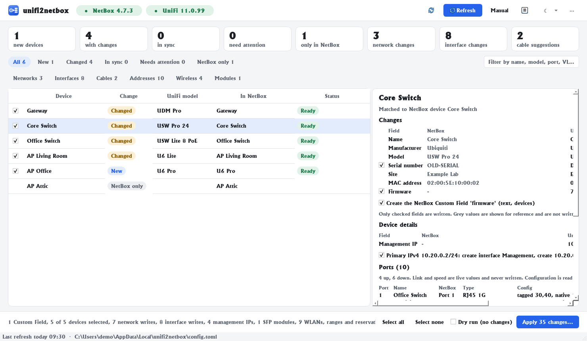

# Your first refresh

Click **Refresh** (or press **F5**). The app reads NetBox and UniFi (and the
optional services), matches the devices and builds the review. This only
reads; nothing is written.

## Reading the summary

The cards at the top count what the refresh found:

| Card | Meaning |
| --- | --- |
| new devices | UniFi devices without a NetBox device; can be created |
| with changes | matched devices whose NetBox values differ |
| in sync | matched devices without differences |
| need attention | rows that need a decision (for example a device type) |
| only in NetBox | NetBox devices that UniFi does not report |
| network changes | VLANs and prefixes to create or align |
| interface changes | switch ports whose NetBox interface differs |
| cable suggestions | links UniFi reports between two devices |

Click a card to filter the table. The filter buttons below the cards do the
same and also open the lists for addresses, wireless LANs and modules.

## Snapshots and offline use

Each successful refresh is stored as a snapshot next to the configuration.
If a service cannot be read, the last good snapshot is shown and marked
stale; stale data can be reviewed but never authorizes a write.

## Next steps

- Understand the window: [The review window](../03-review/index.md).
- Decide what to write: [Devices](../03-review/01-devices.md).
- Try it safely: [Dry run and apply](../04-applying/01-dry-run-and-apply.md).
