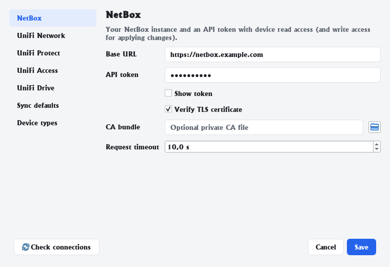

# NetBox

- **Base URL**: the address of your NetBox, for example
  `https://netbox.example.com`. Do not add `/api`.
- **API token**: create it in NetBox under your user profile (**API
  Tokens**). For reviewing only, read access is enough. To apply changes the
  token needs write access to the objects the app writes; the full list is in
  [Permissions](../06-reference/02-permissions.md).
- **Verify TLS certificate**, **CA bundle**, **Request timeout**: see
  [Settings](index.md#common-fields).

The NetBox chip turns green when the version and the device inventory can be
read. A token that can read but not write still shows green; write errors
appear only when you apply.

Supported: NetBox Community 4.7. Wireless LANs need NetBox 4.2 or later.
