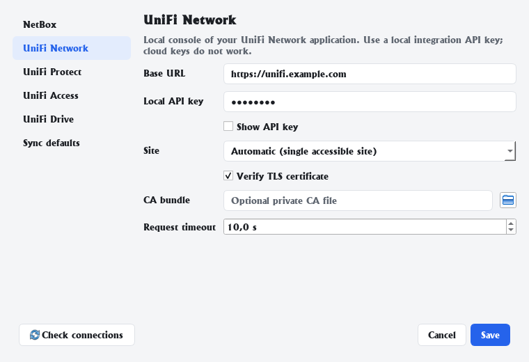

# UniFi Network

- **Base URL**: the local address of the console running UniFi Network (for
  example your gateway or Cloud Key), such as `https://192.168.1.1` or
  `https://unifi.example.com`.
- **Local API key**: create it on that console in the UniFi settings under
  **Integrations** (local API key). Cloud (Site Manager) keys do not work.
- **Site**: **Automatic** uses the only site the key can see. If the key sees
  several sites, choose one from the list (discovered after **Check
  connections**) or type its name or ID.

## What is read

- From the official Integration API: devices (name, model, MAC, serial,
  state, IP address, firmware), ports, networks.
- From UniFi Network 11.0 also, with GET requests and a fixed list of
  allowed fields: port configuration (names, VLANs, profiles, LAG, fixed
  speed), uplinks and LLDP neighbors, SFP modules, wireless networks (never
  their passphrases), DHCP pools and fixed client IPs.

If one of these extra reads fails, the rest still arrives and the review shows
a note. The app never logs in with a user name and password and never writes
to UniFi.
