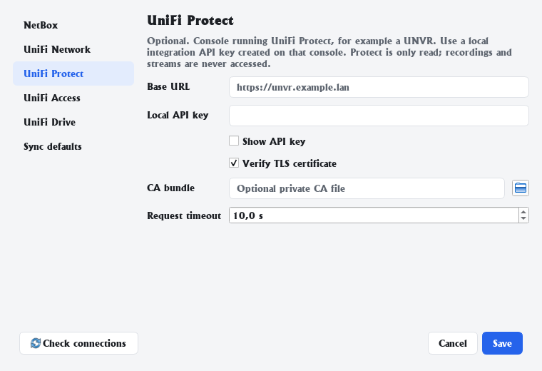

# UniFi Protect

Optional. Adds the NVR and the cameras to the review.

- **Base URL**: the console that runs Protect, for example a UNVR. This can
  be a different console than UniFi Network.
- **Local API key**: a local integration API key created on that console.

## In the review

Protect devices appear as devices marked *from UniFi Protect*. A device that
UniFi Network also reports (same MAC) is taken from Network. Cameras and NVRs
never get the default network role: create fitting roles in NetBox (for
example `Camera` and `NVR`) and choose them per device. Third-party cameras
get a device type only when the model matches exactly.

Recordings and video streams are never accessed. If Protect cannot be read,
NetBox and UniFi Network work as usual.
