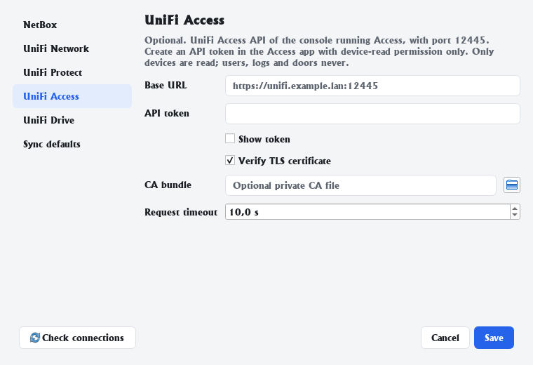

# UniFi Access

Optional. Adds Access hubs, readers and intercoms to the review.

- **Base URL**: the Access API of the console running UniFi Access, with port
  `12445`, for example `https://unifi.example.lan:12445`.
- **API token**: create it in the UniFi Access app as an API token with
  device-read permission only.

## In the review

Access devices appear marked *from UniFi Access*. For the same MAC, UniFi
Network wins over Access, and Access over Protect. Access reports no serial
numbers, so these devices match by name or MAC.

Only devices are read: users, door events, logs and doors are never read.
