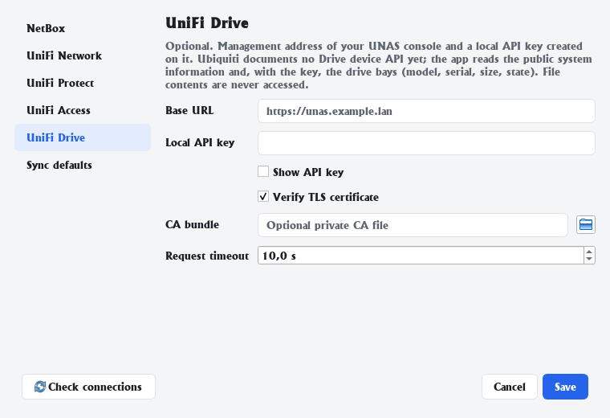

# UniFi Drive

Optional. Adds a UniFi UNAS and its drive bays.

- **Base URL**: the management address of the UNAS console.
- **Local API key**: a local API key created on the UNAS.

## In the review

The UNAS appears as one device. Its drive bays (model, serial, firmware,
size, state) are listed in the device's detail panel. Once the UNAS exists
in NetBox, each drive can be written as an inventory item `Disk <slot>`
(part ID, serial, description). Items are created and updated, never deleted.

Ubiquiti has not documented a Drive API yet; the app reads the public system
information and the storage overview with GET requests. File contents are
never accessed.
