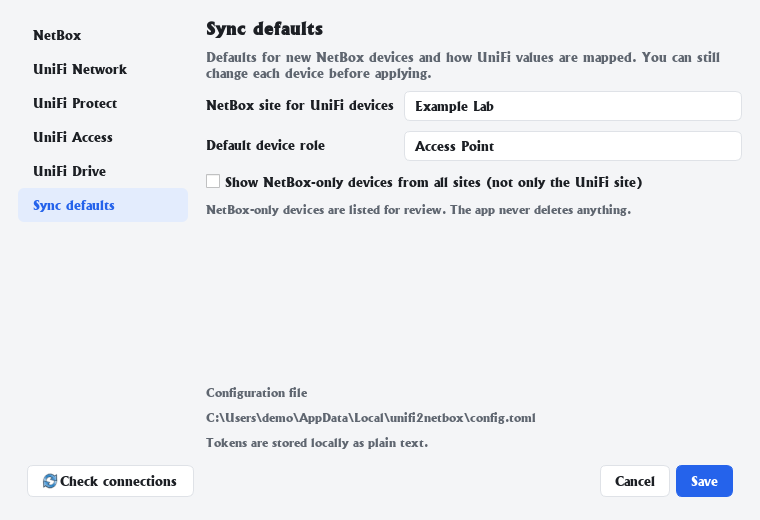

# Sync defaults

## NetBox site for UniFi devices

The NetBox site your UniFi devices belong to. It is used for matching, for
new devices, as the scope of the VLAN group, prefixes and wireless LANs, and
to limit the NetBox-only list. Choose an existing NetBox site; the app never
creates sites.

Without it, a UniFi site name that NetBox does not know is never written,
new devices need a site per row, and networks, wireless LANs, IP ranges and
reservations cannot be planned.

## Default device role

The NetBox role given to new devices. You can still change the role per
device before applying. Protect and Access devices never get this default.

## Show NetBox-only devices from all sites

Off (default): the **NetBox only** list contains only devices of the NetBox
site above. On: all NetBox devices that UniFi does not report. Either way the
app never deletes anything.

At the bottom the page shows the path of the configuration file.
