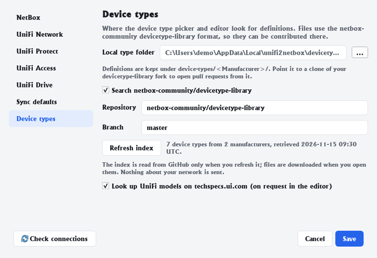

# Device types

- **Local type folder**: where your device type definitions are kept
  (`device-types/<Manufacturer>/`). Empty uses `devicetype-library` next to the
  configuration. Point it to a clone of your devicetype-library fork to
  contribute definitions.
- **Search netbox-community/devicetype-library**: include the library in the
  device type picker. **Repository** (`owner/name`) and **Branch** choose the
  source; **Refresh index** reads the file list from GitHub.
- **Look up UniFi models on techspecs.ui.com**: allow the editor and **New**
  to read product data from techspecs.ui.com.

Nothing is read from GitHub or techspecs.ui.com until you refresh, choose a
library file or look a model up. See [Device types](../04-device-types/index.md).
