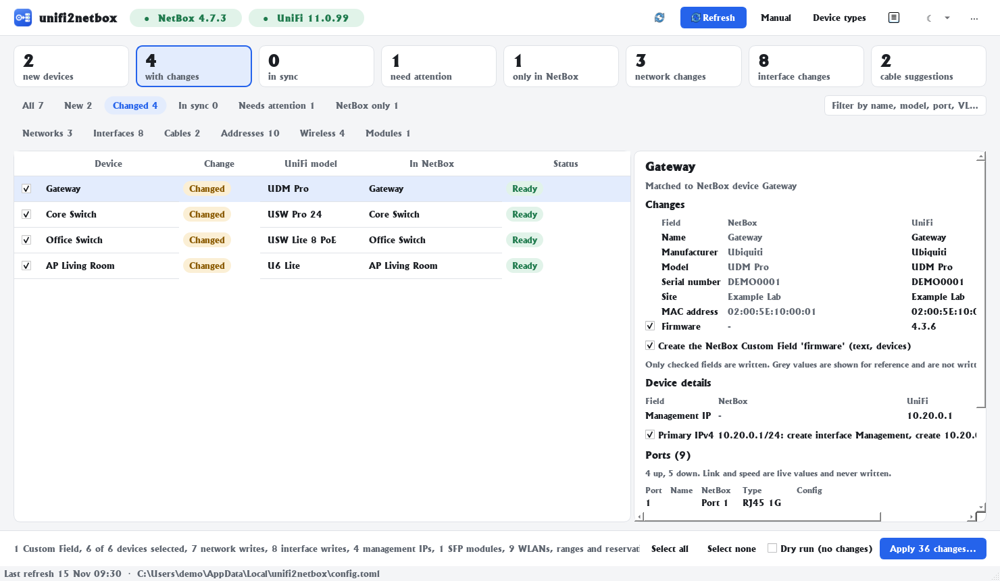
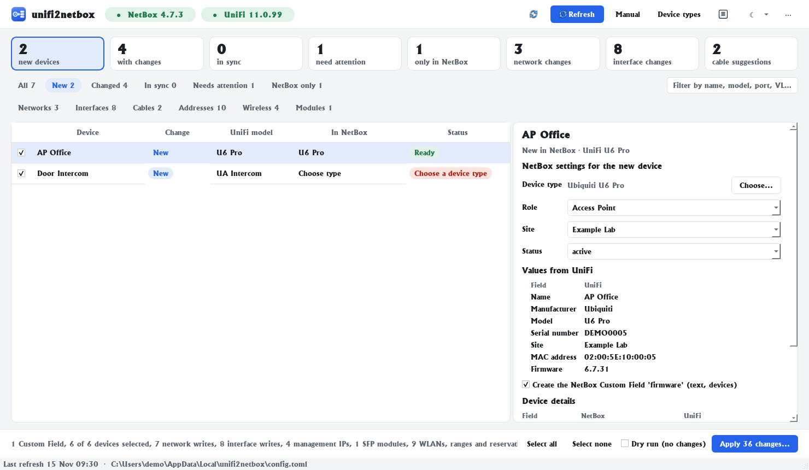
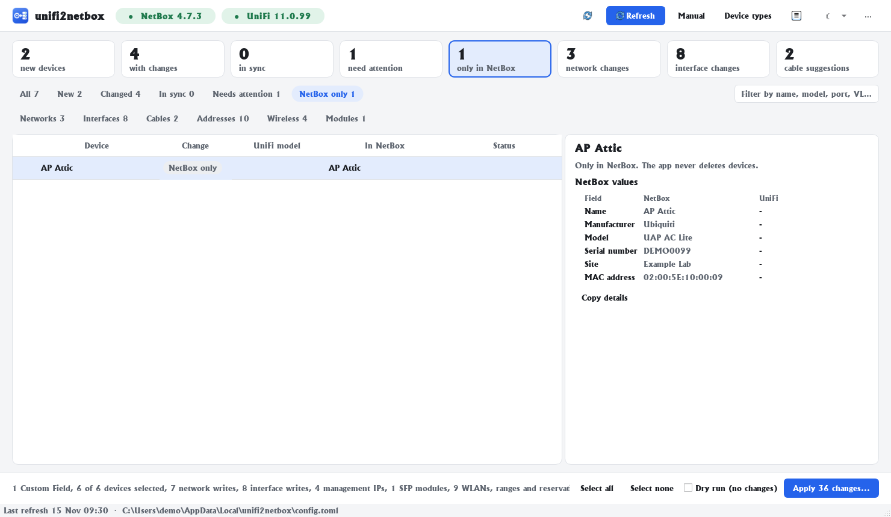

# Devices

The device filters (**All**, **New**, **Changed**, **In sync**, **Needs
attention**, **NetBox only**) list UniFi devices and their NetBox
counterparts.

## How devices are matched

For each UniFi device the app looks for a NetBox device in this order:

1. a mapping you confirmed earlier,
2. the same name (ignoring case and spacing),
3. the same serial number,
4. the same MAC address.

If one step finds more than one NetBox device, the row is an ambiguity
conflict and is never matched automatically. Rename or fix the duplicate in
NetBox and refresh.

## Changed devices

The detail panel lists the fields side by side. Checkboxes appear only for
fields the app can write: **Name**, **Serial number**, **Site** and
**Firmware**. Other differences (for example the UniFi model name versus the
NetBox device type) are shown for reference. Empty UniFi values never clear a
NetBox value.

Below the fields the panel shows the management IP and, for switches, the
port list. See [Firmware and management IP](02-firmware-and-management-ip.md).

## New devices

A UniFi device without a NetBox match can be created. Choose:

- **Device type**: a matching NetBox device type is preselected when it is
  unambiguous. **Choose...** opens the [device type picker](../04-device-types/01-choosing.md),
  which also finds definitions in your local type folder and the
  devicetype-library, or drafts a new one; those are
  [imported on apply](../04-device-types/04-import.md).
- **Role**: the default role from [Sync defaults](../02-settings/06-sync-defaults.md)
  or any NetBox role.
- **Site** and **Status**.

Rows without a device type or role show **Needs attention** and block a full
apply until you decide or uncheck them.

## In sync

Matched devices without differences. Nothing to do.

## NetBox only

NetBox devices that UniFi does not report, by default only from the NetBox
site in Sync defaults. They are listed for your review only: the app never
deletes anything. Decide in NetBox whether the device is gone, offline or
documented elsewhere.

## Apply this device

**Apply this device** in the detail panel writes only the selected device
(with its firmware and management IP), for example when other rows still need
attention.
