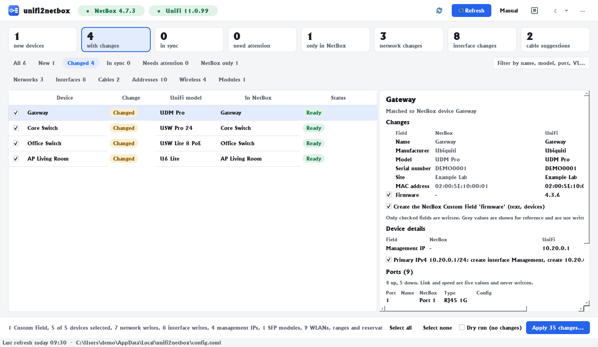

# Firmware and management IP

Both appear in the detail panel of a matched device.

## Firmware

The firmware version UniFi reports is written into the NetBox Custom Field
`firmware` of the device.

- If NetBox has no such field, the panel shows **Create the NetBox Custom
  Field 'firmware' (text, devices)**. It is checked by default and created
  once, before any other write.
- Unchecking it also unchecks all firmware values, because they cannot be
  written without the field. Checking a firmware value checks it again.
- If a field named `firmware` exists with another type or for other objects,
  the app never changes it and firmware is not written.

This is the only Custom Field the app ever creates. The NetBox token needs
permission to add Custom Fields for this one step.

## Management IP

The IP address UniFi reports for the device becomes its NetBox primary IPv4.
The checkbox describes the planned steps, for example *Primary IPv4
10.20.0.1/24: create interface Management, create IP, set primary IPv4*.

- The prefix length comes from the UniFi network that contains the IP.
- The IP goes onto the device's management-only interface, an interface named
  `Management`, or a new virtual, management-only interface `Management`.
- A missing IP is created; an unassigned one is assigned.
- Conflicts that are never overwritten: the device already has another
  primary IPv4, the IP is assigned to another object, the IP exists twice, or
  the device has several management-only interfaces.
- Public (WAN) addresses are only noted, never written.
- Devices created in the same run get their management IP after the next
  refresh.

All management IPs are also listed under [Addresses](06-addresses.md).
