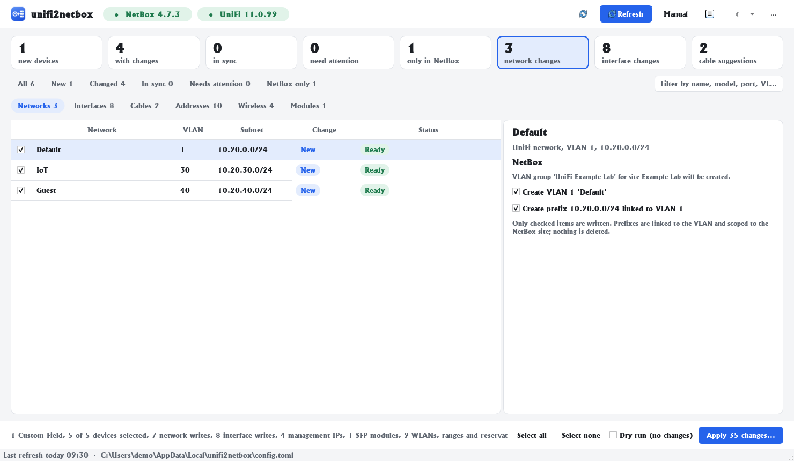

# Networks

The **Networks** filter lists the UniFi networks and plans NetBox IPAM for
the NetBox site from [Sync defaults](../02-settings/06-sync-defaults.md).

For the site the app plans:

- one VLAN group **UniFi \<site\>**, scoped to the site,
- one VLAN per enabled UniFi network in that group,
- one prefix per network subnet, scoped to the site and linked to its VLAN.

Each network row has two checkboxes in the detail panel: the VLAN and the
prefix. The VLAN group is created automatically together with the first VLAN.

## Existing objects

- A VLAN with another name is renamed to the UniFi name.
- A prefix without a VLAN gets the VLAN.
- **Conflicts** (shown, never written): a prefix linked to another VLAN, the
  same prefix twice, two UniFi networks with the same VLAN ID.
- Disabled UniFi networks are shown for reference only.

Write the networks first: interfaces, wireless LANs and the VLANs of ports
use the VLAN group. In one run the app writes networks before everything that
depends on them; VLANs created in the same run are picked up by interfaces
and wireless LANs after the next refresh.
