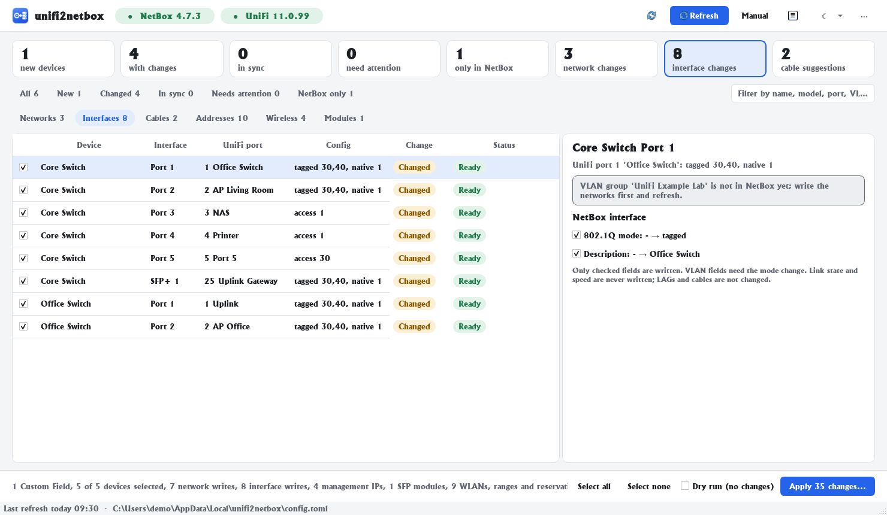

# Interfaces

The **Interfaces** filter compares the configuration of UniFi switch ports
with the paired NetBox interfaces of matched devices.

## How ports are paired

UniFi ports and NetBox interfaces of the same device are paired by connector
kind (copper, SFP, SFP+, …), then by family, in numbering order. Unpaired
ports or interfaces are listed in the device's port list.

## What can be written

| Field | Source |
| --- | --- |
| Enabled | the port is switched on or off in UniFi (not the link state) |
| 802.1Q mode | access, tagged or tagged-all, from the port profile and overrides |
| Untagged and tagged VLANs | from the VLAN group `UniFi <site>`; write the networks first |
| Description | the UniFi port name, unless it is a default name such as `Port 3` |
| Speed and duplex | only when auto-negotiation is off in UniFi |
| PoE mode and type | `pse` with the PoE standard of the port |

Each field has its own checkbox. Empty NetBox values are preselected; other
existing NetBox values (for example PoE from the device type or a hand-written
description) are shown, but only replaced when you check them. A VLAN change
always goes together with the mode change.

Interfaces are only updated, never created or deleted. The live link state and
speed are never written. LAGs are shown but not changed.
