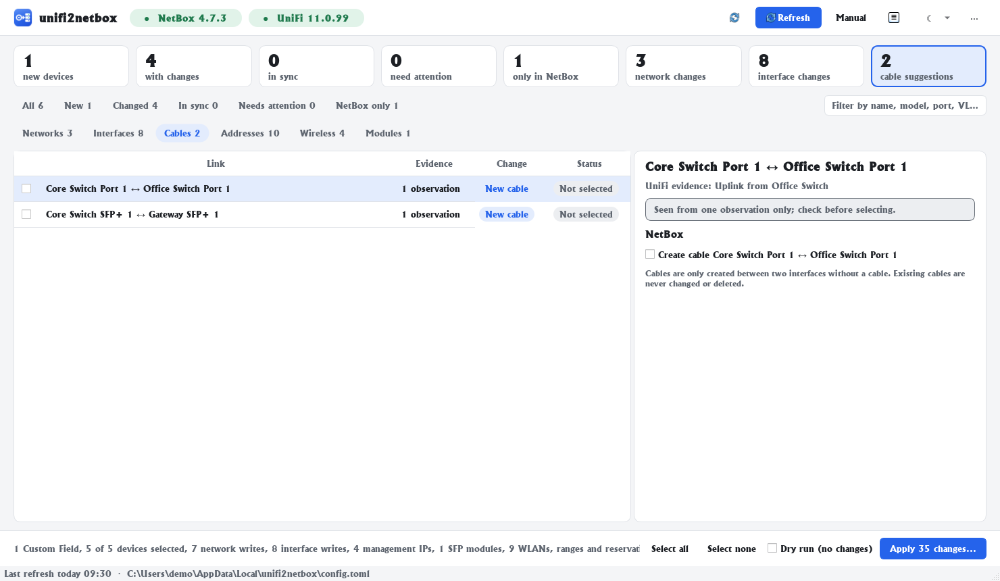

# Cables

The **Cables** filter lists links that UniFi reports between two devices:
wired uplinks and LLDP neighbors.

A NetBox cable is suggested only when

- both ends are interfaces of matched devices,
- the evidence agrees on both ports, and
- neither interface has a cable yet.

The **Evidence** column says how many observations support the link.
Suggestions seen twice (for example an uplink plus LLDP) are preselected; a
single observation is shown but not checked, so check it yourself after
verifying the link.

Cables are only created. Existing cables are never changed or deleted.
Links whose other end is not a NetBox interface are shown as *Reference*.
