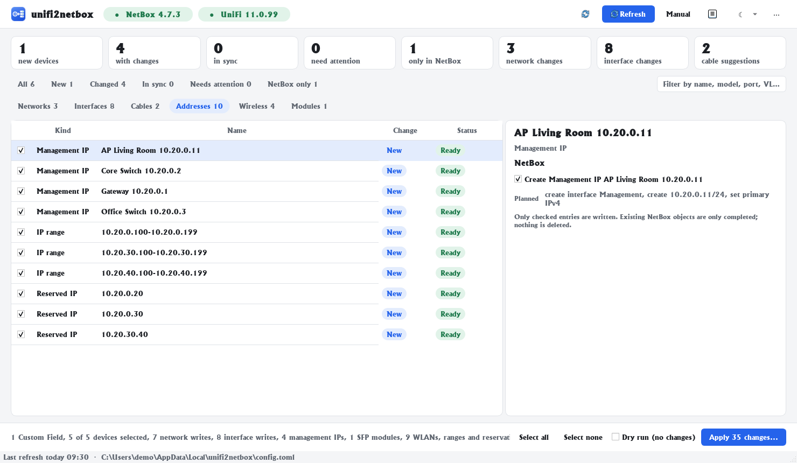

# Addresses

The **Addresses** filter lists three kinds of entries:

- **Management IP**: the primary IPv4 of a matched device, see
  [Firmware and management IP](02-firmware-and-management-ip.md).
- **IP range**: the DHCP pool of a UniFi network.
- **Reserved IP**: a client with a fixed IP address in UniFi.

## IP ranges

Each UniFi network with an enabled DHCP server becomes a NetBox IP range
from the first to the last pool address, with the prefix length of the
network, status *active* and the description `DHCP <network>`.

An existing range with the same bounds is only completed (an empty
description is filled). A NetBox range that overlaps with other bounds is a
conflict.

## Reserved IPs

Each UniFi client with a fixed IP becomes a NetBox IP address with status
*reserved*, not assigned to any device:

- **Address**: the fixed IP with the prefix length of the UniFi network that
  contains it. IPs outside every UniFi network are only noted.
- **DNS name**: only from an enabled local DNS record in UniFi.
- **Description**: the client name, else its host name.

An existing NetBox IP is only completed: empty DNS names and descriptions
are filled; a different DNS name or description is a conflict. The status of
an existing IP is never changed. An IP reserved for several UniFi clients is
left out.

## Selecting

Each entry has a checkbox in the list and in the detail panel. **Select
none** clears the whole visible list, for example to write only a few
reservations. IP ranges and reserved IPs are written on a full apply only,
not with **Apply this device**.
