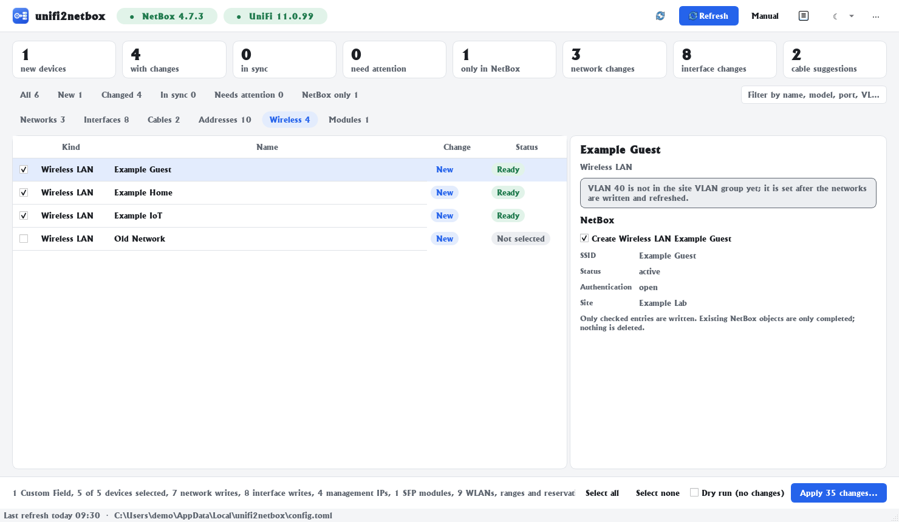

# Wireless

The **Wireless** filter lists the UniFi wireless networks as NetBox wireless
LANs for the NetBox site.

| NetBox field | From UniFi |
| --- | --- |
| SSID | the network name |
| Status | *active*, or *disabled* for a switched-off WLAN |
| Authentication | `open`, `wep`, `wpa-personal` (WPA PSK) or `wpa-enterprise` |
| Cipher | `aes` (CCMP/GCMP), `tkip` or `auto` |
| VLAN | the VLAN of the WLAN's network from the VLAN group `UniFi <site>` |
| Site | the NetBox site from Sync defaults |

The passphrase is never read and never written.

- Disabled WLANs are shown but not preselected.
- If the VLAN is not in NetBox yet, the WLAN is planned without it and a note
  says so; write the [networks](03-networks.md) and refresh.
- An existing NetBox wireless LAN with the same SSID gets status and
  authentication from UniFi and an empty VLAN or site filled in. A different
  VLAN or site is a conflict. Two NetBox WLANs with the same SSID are a
  conflict.

Wireless LANs are written on a full apply only.
