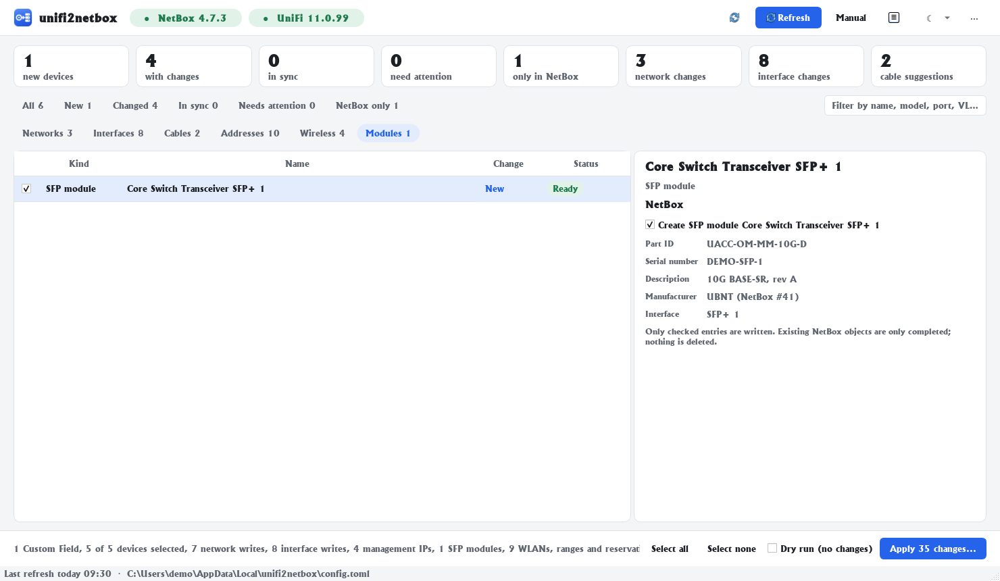

# Modules

The **Modules** filter lists the SFP modules plugged into ports of matched
devices.

Each module becomes a NetBox inventory item of the device:

| Field | Value |
| --- | --- |
| Name | `Transceiver <interface>`, for example `Transceiver SFP+ 1` |
| Component | the paired NetBox interface |
| Part ID, serial | from the module |
| Description | the module standard and revision, for example `10G BASE-SR, rev A` |
| Manufacturer | the NetBox manufacturer that matches the vendor (`UBNT` and `Ubiquiti Inc.` match `Ubiquiti`) |

If no single NetBox manufacturer matches, the item has none and a note says
so; the app never creates manufacturers. Create the manufacturer in NetBox and
refresh to have it filled in.

Items are created and updated, never deleted. When a module is removed, its
item stays; when another module is plugged in, the item is updated and a note
shows the change. A port that is not paired with a NetBox interface is noted.

## Drives of a UNAS

Drive bays of a UniFi UNAS work the same way (items `Disk <slot>`), but they
are listed in the UNAS device's detail panel rather than here. See
[UniFi Drive](../02-settings/05-unifi-drive.md).
