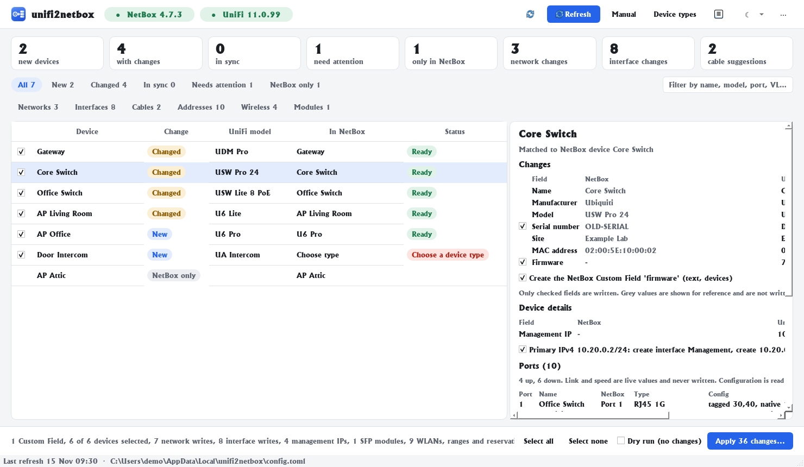
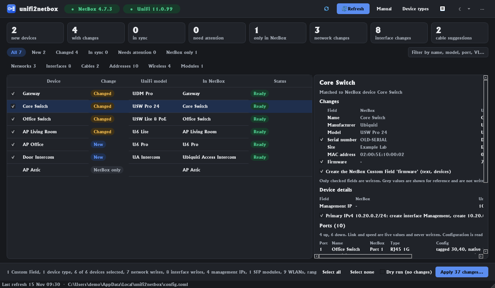

# The review window

After a refresh the main window shows everything the app could write. The
window follows the system light or dark mode; the moon/sun button switches
between light and dark, and its arrow menu offers **Follow system**.

## Header

- **Connection chips**: one per configured service, see
  [First start](../01-getting-started/02-first-start.md#the-connection-chips).
- **Check connections** (round arrows): checks all connections again.
- **Refresh** (F5): reads all inventories and rebuilds the review.
- **Manual** (F1): opens this manual.
- **Device types**: opens the [device type editor](../04-device-types/02-editor.md).
- **Settings**: see [Settings](../02-settings/index.md).
- **Light/dark** button.
- **⋯ More**: **Write history**, **Export UniFi API dump**, **Copy summary**,
  **Device types...**, **Manual** and **Exit**.

On a narrow window the header gets compact: the chips show only the service
name (the color still shows the state; hover for version and details), and
**Manual** and **Device types** become icons.

## Summary cards and filters

The cards count new devices, changed devices, devices in sync, rows that need
attention, NetBox-only devices, network changes, interface changes and cable
suggestions. Clicking a card filters the table.

The filter buttons below have two rows:

- **Devices**: All, New, Changed, In sync, Needs attention, NetBox only. See
  [Devices](01-devices.md).
- **Infrastructure and objects**: [Networks](03-networks.md),
  [Interfaces](04-interfaces.md), [Cables](05-cables.md),
  [Addresses](06-addresses.md), [Wireless](07-wireless.md) and
  [Modules](08-modules.md).

The search field filters the visible list by name, model, port, VLAN or
subnet.

## Table and detail panel

The table lists one entry per row with a checkbox, the kind of change and a
status:

| Status | Meaning |
| --- | --- |
| Ready | selected and will be written |
| Not selected | could be written but is not checked |
| Needs attention | a decision is missing (device type, role, site) or a blocker exists |
| Conflict | NetBox holds data the app does not overwrite; see the note |
| Written / Verified | written in this session; Verified after the read-back |
| Skipped | not written, for example because data changed since the preview |
| Failed | NetBox rejected the write; the detail panel shows why |

The detail panel on the right shows the selected entry: values from UniFi and
NetBox side by side, a checkbox for each writable field, notes and, after a
run, the result.

## Apply bar

At the bottom the bar sums up the selection (for example *1 Custom Field,
5 of 5 devices selected, 7 network writes …*), offers **Select all** and
**Select none** for the visible list, the **Dry run (no changes)** switch and
**Apply N changes**. See [Applying changes](../05-applying/index.md).
