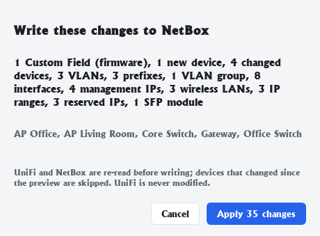

# Dry run and apply

## The apply bar

The bar at the bottom of the window sums up the selection and has three
controls:

- **Select all** / **Select none**: for the list currently shown.
- **Dry run (no changes)**: when checked, the button reads **Dry run N
  changes** and nothing is written.
- **Apply N changes**: opens the confirmation.

## Confirmation

The dialog counts what will be written (Custom Field, new and changed
devices, VLANs, prefixes, VLAN group, interfaces, cables, management IPs,
wireless LANs, IP ranges, reserved IPs, drive and SFP items) and lists the
first device names. Blockers (for example a new device without a role) are
shown in red and prevent the run; warnings are shown in amber.

Click **Apply N changes** to write, or **Cancel**.

## Dry run

A dry run performs every check of a real run (UniFi and NetBox are read
again, duplicates are looked up, drift is detected) and reports for each
change what would happen, but writes nothing. Its results appear in the table
and in the [write history](03-write-history.md).

## After a run

- The banner summarizes the run: successes, failures, skipped changes and the
  read-back result.
- Each row shows **Verified**, **Written**, **Skipped** or **Failed**; the
  detail panel shows the message.
- Click **Refresh now** in the banner: written rows then show *In sync*, and
  rows that depend on them (for example interface VLANs after new VLANs) are
  planned.

## Apply this device

**Apply this device** in a device's detail panel runs only that device (with
its firmware and management IP). Networks, interfaces, cables, wireless LANs,
IP ranges, reservations and modules are written only by **Apply N changes**.
