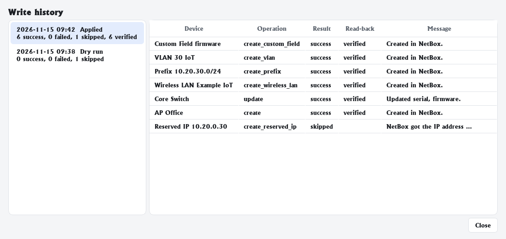

# Write history

**⋯ More > Write history** lists recent runs, real and dry, with their
results.

- Left: one entry per run with date, *Applied* or *Dry run*, and a summary
  (success, failed, skipped, verified).
- Right: one line per change with the object, the operation, the result, the
  read-back and the message. Hover a message to see the read-back details.

The history is stored in `write-journal.sqlite3` next to the configuration
(see [Files and data](../05-reference/03-files-and-data.md)). It keeps the
record of what the app wrote and why something was skipped, so keep it when
you upgrade.
