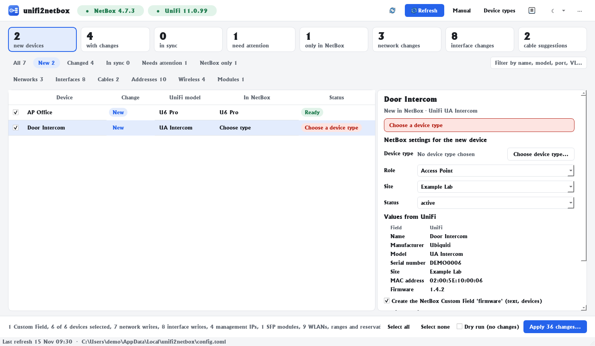
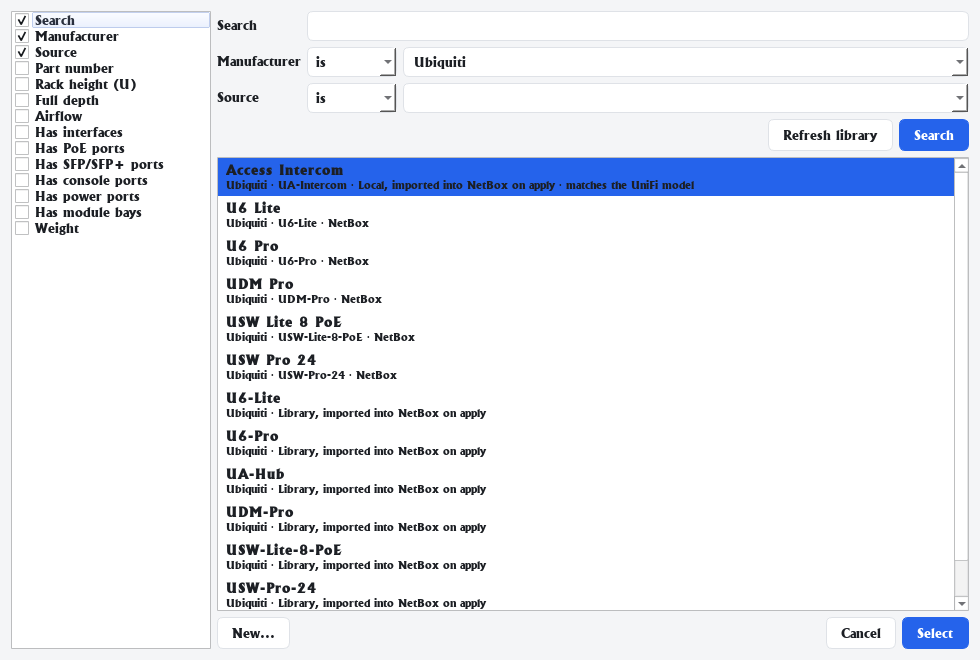

# Choosing a device type

In the detail panel of a new device, **Device type** shows the chosen type or
*No device type chosen*. Click **Choose...** to open the picker.

## The picker

The picker works like NetBox's *Select device type* dialog:

- **Left**: the filter criteria. Check a criterion to add it as a row on the
  right; uncheck it to remove it. Search, Manufacturer and Source are checked
  at the start.
- **Right, top**: one row per criterion. Manufacturer and Source have an
  operator (*is* / *is not*), the others a value. **Search** (or Enter in a
  text field) runs the search.
- **Results**: the model in bold, below it the manufacturer, part number and
  source. Types that match the UniFi model come first and say *matches the
  UniFi model*.

| Criterion | Filters on |
| --- | --- |
| Search | model, part number and file name, including UniFi spellings (`USW Pro 24` finds `USW-Pro-24`) |
| Manufacturer, Source | exact manufacturer; NetBox, Local or Library |
| Part number | text in the part number |
| Rack height, Full depth, Airflow, Weight | attributes of the definition (weight: at most) |
| Has interfaces, PoE, SFP/SFP+, console, power ports, module bays | components of the definition |

NetBox types and library files that were not downloaded yet have no component
details; such filters skip them and the note says how many.

## Sources

- **NetBox**: the device types NetBox already has; nothing is imported.
- **Local**: definitions in your [local type folder](03-folder-and-library.md).
- **Library**: the netbox-community devicetype-library. **Refresh library**
  reads its index from GitHub (also in Settings > Device types).

Choosing a local or library type marks it *imported on apply*; see
[Importing into NetBox](04-import.md).

## New

**New...** opens the [editor](02-editor.md) with a draft built from the
device's UniFi data. For Ubiquiti models the app also looks the model up on
techspecs.ui.com. When you save the draft, it becomes the device's type.
