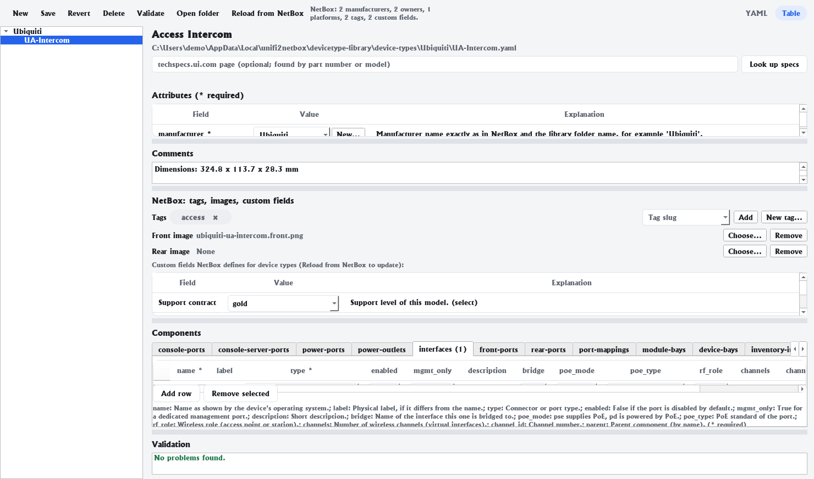
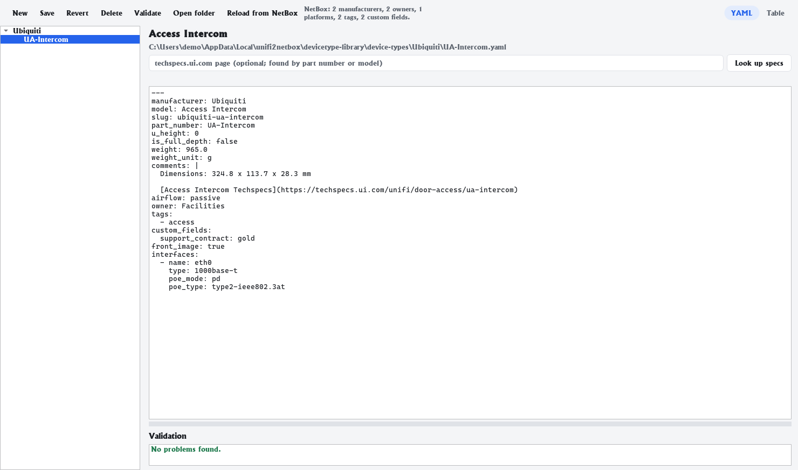

# The device type editor

Open it with **Device types** in the header, **⋯ More > Device types...**, or
**New...** in the picker.

- **Left**: your local type folder as a tree, one folder per manufacturer.
  Click a file to open it.
- **Right**: the selected definition. **Table** and **YAML** switch the view;
  both edit the same definition.
- **Toolbar**: **New**, **Save**, **Revert**, **Delete** (asks first; local
  files and their images only), **Validate**, **Open folder** and **Reload
  from NetBox** (reads the drop-down lists again; next to it the editor
  shows how many objects NetBox has).

Drag the lines between Attributes, Comments, NetBox, Components and
Validation to
change their heights, and the line next to the tree to change its width. The
editor remembers these sizes and its window size and position for the next
time.

## Table view

- **Attributes**: one row per field with an explanation. Required fields are
  marked with `*`. Fields with fixed choices (airflow, cooling method, weight
  unit, yes/no) offer a list. **Manufacturer**, **owner** and **default
  platform** are drop-downs of the objects in NetBox; you can also type a
  name. **New...** creates the object in NetBox (see
  [NetBox fields](05-netbox-fields.md)). End of life is a date
  (`YYYY-MM-DD`).
- **Comments**: free text, for example the techspecs link.
- **NetBox**: tags, front and rear image and custom fields (see
  [NetBox fields](05-netbox-fields.md)).
- **Components**: one tab per template kind (console ports, power ports and
  outlets, interfaces, front and rear ports, port mappings, module and device
  bays, inventory items, cooling intakes and outflows). **Add row** and
  **Remove selected** edit the rows; hover a column header for its meaning.
  Connector, PoE and cooling types come as lists. Columns that name another
  component (an outlet's power port, an interface's parent or bridge, a port
  mapping's front and rear port, an outflow's cooling intake, an inventory
  item's parent and component) are drop-downs of this definition's
  components; inventory item roles and manufacturers come from NetBox.

Values you do not change keep their original spelling, so a file from the
library is saved back unchanged.

## YAML view

The raw file. Invalid YAML is reported and keeps you in this view until it
is fixed.

## Validation

The list at the bottom shows problems after opening, saving and
**Validate**:

- **Errors**: the schema (required fields, allowed values, unknown
  fields) and the library's contribution rules: the file name is the model
  or part number, the folder is the manufacturer, the slug starts with the
  slugified manufacturer and ends with the slugified model or part number,
  no empty values, no duplicate component names, a weight needs a unit.
  A component reference must name a component of this definition (for
  example an outlet's power port), and a component cannot be its own
  parent.
- **Warnings**: weight, weight unit and airflow are recommended by the
  library. A manufacturer, owner, platform, tag, inventory item role or
  custom field that NetBox does not have is a warning; the import stops
  until it exists.

Saving with errors asks first. The file is saved as
`device-types/<Manufacturer>/<part number or model>.yaml`; changing the model
or part number renames it.

## techspecs.ui.com (UniFi models)

For Ubiquiti definitions a row offers **Look up specs**. It finds the product
page by part number or model, or uses the page URL you paste (for example
`https://techspecs.ui.com/unifi/door-access/ua-intercom?s=eu`). The lookup
only fills gaps: part number, rack height, weight, the techspecs link and,
if the definition has none, interfaces from the port layout. Values you
entered are kept. Other manufacturers are filled in by hand.
