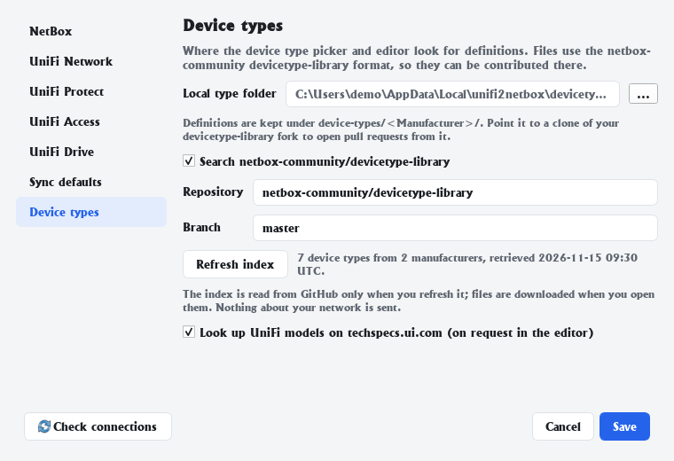

# The local type folder and the library

## Local type folder

Definitions you create or edit are kept in a folder shaped like the
devicetype-library:

```text
devicetype-library/
  device-types/
    Ubiquiti/
      UA-Intercom.yaml
      U6-Pro.yaml
  elevation-images/
    Ubiquiti/
      ubiquiti-ua-intercom.front.png
```

By default it is `devicetype-library` next to the configuration
(`%LOCALAPPDATA%\unifi2netbox` on Windows, `~/.config/unifi2netbox` on Linux).
Change it in **Settings > Device types**.



## Contributing to the library

Files written by the app follow the library's `CONTRIBUTING.md` (file names,
slugs, style). Fields only NetBox knows (owner, default platform, tags,
custom fields, cooling method, end of life, exclude from utilization and the
cooling sections) are not part of the library schema: remove them from a
copy before you submit it. To submit definitions:

1. Fork [netbox-community/devicetype-library](https://github.com/netbox-community/devicetype-library)
   and clone your fork.
2. In **Settings > Device types** set **Local type folder** to the clone.
3. Create or edit the definitions in the app; they land in
   `device-types/<Manufacturer>/`.
4. Add `weight`, `weight_unit` and `airflow` where known, check the data
   against the data sheet, and run the library's pre-commit checks.
5. Commit on a branch such as `ubiquiti-access` and open a pull request.

## The devicetype-library as a search source

With **Search netbox-community/devicetype-library** checked (default), the
picker includes the library. **Refresh index** (Settings or picker) reads the
list of files from GitHub once and keeps it next to the configuration; a file
is downloaded when you choose it and kept by its version. **Repository** and
**Branch** can point to your fork.

Uncheck the option to work without GitHub. **Look up UniFi models on
techspecs.ui.com** switches the techspecs lookups on or off.
