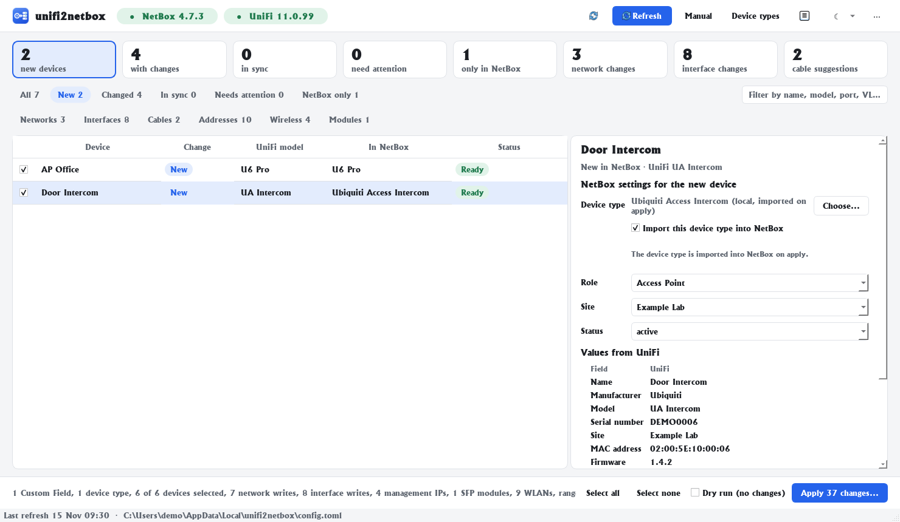

# Importing into NetBox

A new device whose chosen type is a local or library definition shows the
type as *imported on apply*, with a checkbox **Import this device type into
NetBox**.

## What happens on apply

The import runs right after the Custom Field and before any device is
written:

1. NetBox is read again. If a type with the same slug exists by now, it is
   used and nothing is created.
2. The owner, default platform, tags, inventory item roles and
   manufacturers the definition names are looked up in NetBox. If one is
   missing, nothing is written for this type (see below).
3. The device type is created with all its fields: model, slug, part number,
   height, depth, exclude from utilization, airflow, cooling method, weight,
   end of life, owner, default platform, tags, custom fields, description and
   comments.
4. Its component templates are created in an order that keeps references
   valid: console and console server ports, power ports and outlets,
   interfaces (parents and bridges are set once all exist), rear ports, front
   ports with their port mappings, module bays, device bays, cooling intakes
   and outflows, and inventory items (parents first, with roles,
   manufacturers and components).
5. Local front and rear images are uploaded.
6. The type is read back: fields, template counts and images (*Verified* or
   *Mismatch*).
7. The new devices are created with the new type.

The apply bar and the confirmation count the device types. A dry run checks
everything and creates nothing.

## When the app does not import

| Situation | What you see |
| --- | --- |
| NetBox already has the same manufacturer and model or part number | The existing type is used; nothing is imported. |
| The manufacturer is missing in NetBox | Blocked: create it with **New...** in the editor (or in NetBox) and refresh. |
| An owner, platform, tag, inventory item role or item manufacturer is missing | The import is skipped before anything is written (also in a dry run); choose or create it in the editor. |
| The definition has `front_image` or `rear_image` but no local file | Imported without that image; a note says so. |
| The definition has module bay types | Imported without them; set them in NetBox. |
| The definition is invalid | Blocked: fix it in the editor. |
| The import is unchecked | The devices that need the type are not written. |

A failed image upload is reported but does not undo the type. If the
import fails, the devices that depend on it are skipped with the
reason, so no device is created with a wrong type. An interrupted create is
looked up in NetBox, never repeated blindly.
