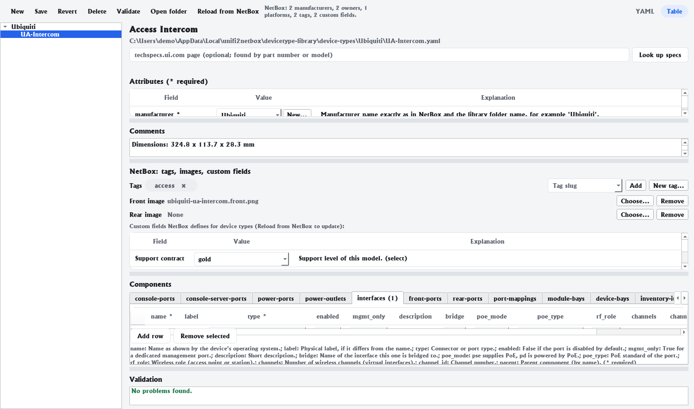
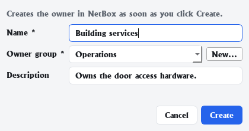

# NetBox fields

Beyond the library format, a definition may use every field NetBox has for
device types. The editor reads the lists it needs from NetBox when it opens
(read-only): manufacturers, owners, owner groups, platforms, tags, inventory
item roles and the custom fields defined for device types. **Reload from
NetBox** reads them again.

## Drop-downs and New...

Manufacturer, owner, default platform and the role and manufacturer of
inventory items are drop-downs of the NetBox objects. **New...** opens a
small dialog with the fields NetBox needs:

| Object | Fields |
| --- | --- |
| Manufacturer | name, slug, description |
| Platform | name, slug, manufacturer, description |
| Owner | name, owner group, description |
| Owner group | name, description |
| Tag | name, slug, color, description |
| Inventory item role | name, slug, color, description |

The slug follows the name until you change it. An owner needs an owner
group; the group list has its own **New...**.

**Create** writes the object to NetBox right away; clicking it is the
approval. If NetBox already has an object with that name or slug, it is
selected instead of creating a second one. An interrupted create is looked
up, never repeated. The object is read back, saved in the write history and
selected in the field that opened the dialog.

## Tags

Tags are kept by their slug. Pick one in the list (or type its slug) and
click **Add**; click a tag to remove it. **New tag...** creates a tag in
NetBox and adds it.

## Images

**Choose...** picks a front or rear image (PNG, JPEG, GIF, WebP or SVG);
**Remove** drops it. The choice is applied when you save: the file is copied
to `elevation-images/<Manufacturer>/<slug>.front.<ext>` (or `.rear.`) in the
local type folder, like in the library, and the definition gets
`front_image: true`. When the manufacturer or slug changes, the images move
with the definition. They are uploaded to NetBox when the type is
[imported](04-import.md).

## Custom fields

One row per custom field NetBox defines for device types, with its label,
type and description. Selections and yes/no fields offer a list; numbers are
stored as numbers; multiple selections are separated by commas. A custom
field in the file that NetBox does not define is kept and marked.
