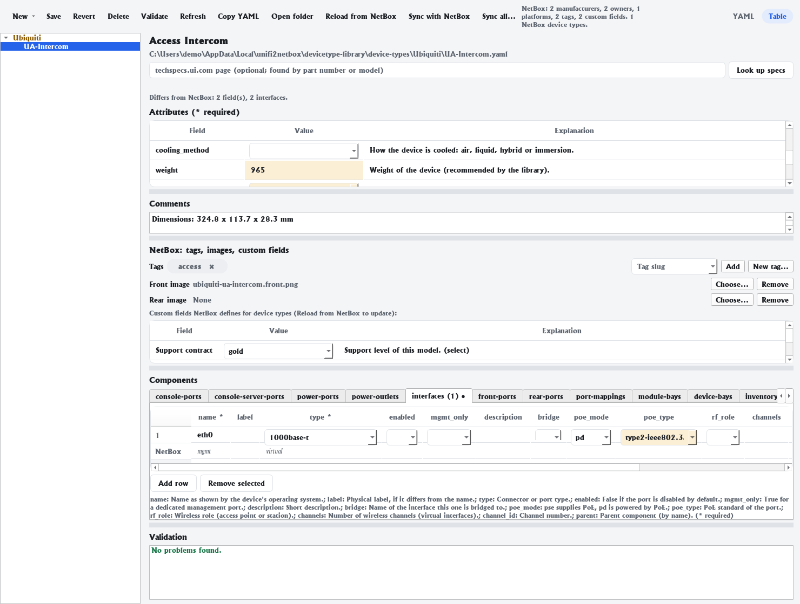
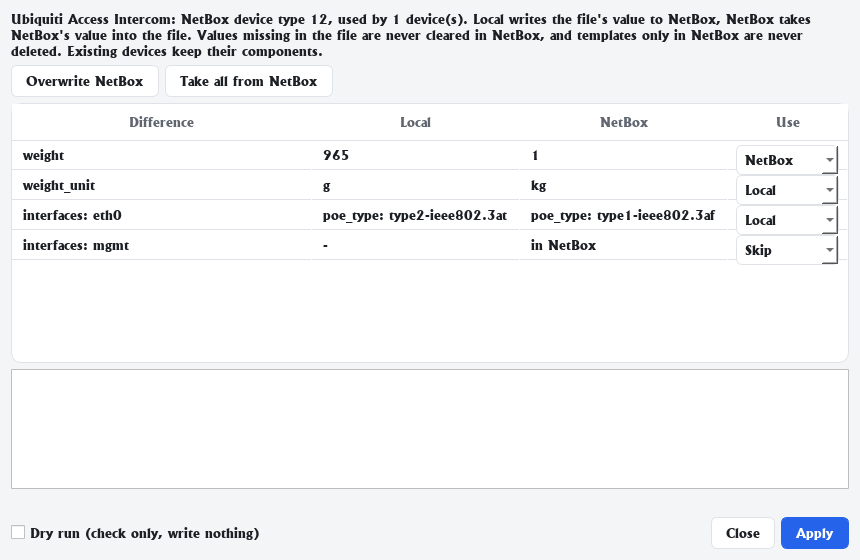

# Syncing with NetBox

The editor reads all NetBox device types when it opens (and on **Reload from
NetBox**) and compares each local definition with its NetBox type: by slug,
else by manufacturer and model or part number.

## Seeing differences

- The tree colors each file: **green** equal to NetBox, **yellow**
  differs, **red** not in NetBox. NetBox types without a local file are not
  listed; use **New > From NetBox...** to get one.
- Above the attributes a line sums up the differences.
- A field or template cell that differs is **yellow**; its tooltip shows the
  NetBox value. Right-click it and choose **Use NetBox value** to take it
  over (for a template row also **Use NetBox values for this row**). Tags,
  custom fields and images work the same way.
- Template rows that exist only in NetBox are shown **greyed out** below the
  definition's rows (marked *NetBox*); right-click **Add to the definition**
  takes one over. Rows that exist only in the file have a **red** name.
- Tabs with differences carry a dot.

## Sync one type

**Sync with NetBox** saves the definition first (it asks) and opens the
differences, one row each, with a choice:

- **Local**: NetBox gets the file's value. A template only in the file is
  created in NetBox.
- **NetBox**: the file gets NetBox's value. A template only in NetBox is
  added to the file; one only in the file is removed from it.
- **Skip**: nothing changes.

**Overwrite NetBox** selects Local wherever possible, **Take all from
NetBox** the other way. Two rules always hold: a value missing in the file
never clears the NetBox value, and a template that exists only in NetBox is
never deleted. A definition that is not in NetBox yet is imported instead.

**Apply** first checks NetBox (read only):

- **Blockers** stop the sync and are listed in red: a new rack height under
  which a mounted device would overlap another one or leave its rack, a
  height of 0 U for mounted devices, a depth change that makes devices
  overlap, a subdevice role change while devices are mounted as children,
  sit in device bays or hold devices in their bays, and a model another
  NetBox type already has.
- **Warnings** are shown in the confirmation: field changes that apply at
  once to all devices of the type (with their number), and template
  changes.

The confirmation lists every step. With **Dry run** checked, the app does
all reads and checks and writes nothing. Otherwise it reads the type again
and stops if NetBox changed since the comparison, looks up the owner,
platform, tags, roles and manufacturers by name (a missing one stops the
sync), writes the steps, looks up interrupted creates instead of repeating
them, and reads NetBox back (*verified* when every chosen value arrived).
NetBox values chosen for the file are saved to it. Every run is saved in the
write history.

## Sync all

**Sync all...** lists every yellow and red definition with a checkbox:
yellow ones overwrite NetBox with the local values, red ones are imported.
The app checks all of them first, then asks once with the steps and
warnings per type; blocked types are skipped. To decide per value, use
**Sync with NetBox** on the type.

## Devices that already use the type

- Field changes (model, part number, height, airflow, weight, owner, tags,
  ...) apply at once to every device of the type.
- Template changes apply only to devices created later. NetBox does not add
  or remove components of existing devices, and neither does the app.
- NetBox refuses changes that do not fit placed devices; the app's checks
  catch the usual cases before anything is written.
- A device type that devices use cannot be deleted, and the app never
  deletes device types.
