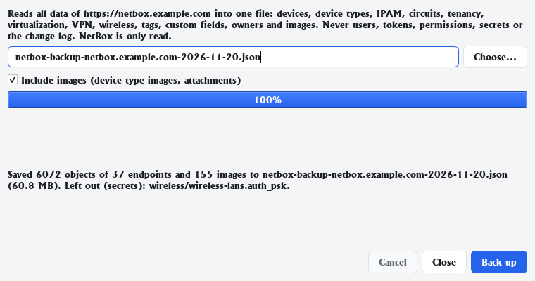

# Backup

**⋯ More > Backup NetBox...** reads the NetBox from
[Settings](../02-settings/01-netbox.md). It only reads.

1. Choose the file. The name proposed is
   `netbox-backup-<host>-<date>.json` in your Documents folder. A name
   ending in `.yaml` writes YAML instead of JSON.
2. Leave **Include images** checked to save device type images and image
   attachments in the file (it gets bigger).
3. Click **Back up**. The bar shows the progress; **Cancel** stops after the
   current endpoint and writes no file.

The summary lists the objects, endpoints and images saved and the secret
fields left out. If an endpoint could not be read, the file is still written
but marked **incomplete**, and the summary names the endpoint.

The file is written in one step: an interrupted backup never leaves a
half-written file behind.
