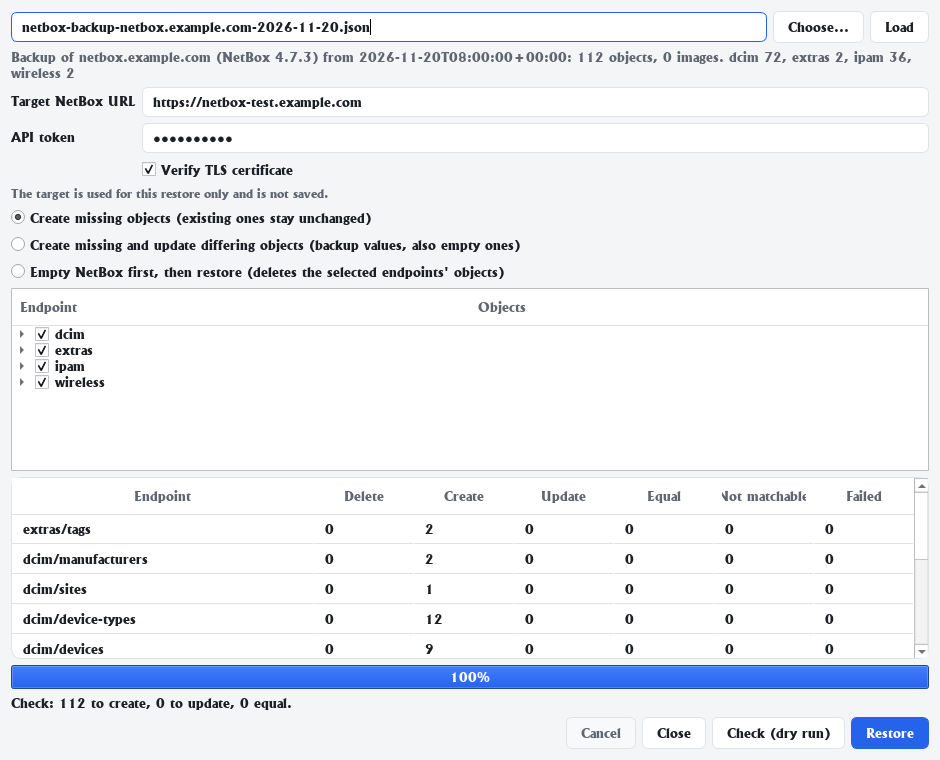

# Restore

**⋯ More > Restore NetBox...** writes a backup into a NetBox.

## Steps

1. **Choose...** or type the backup file and **Load**. The line below shows
   where the backup comes from, its NetBox version, date and object counts.
2. **Target NetBox URL**, **API token**, **Verify TLS certificate**: the
   NetBox to write to. They start with the values from Settings and are used
   for this restore only; they are never saved. Enter a test instance here
   to restore into it without changing your settings. The token needs write
   permission for the restored object types.
3. Choose the **mode** (below).
4. Uncheck apps or endpoints you do not want to restore.
5. **Check (dry run)** reads the target and shows per endpoint what would be
   deleted, created, updated, what is already equal and what cannot be
   matched. Nothing is written.
6. **Restore** asks for confirmation and runs. Changing the target, mode or
   selection after the check requires a new check.

## Modes

- **Create missing objects**: objects the target does not have are created;
  existing ones stay as they are.
- **Create missing and update differing objects**: also updates existing
  objects to the backup's values, including empty values (a restore
  restores). The check lists every object that would change with its
  fields; uncheck those that should keep their current values.
- **Empty NetBox first, then restore**: deletes the objects of the selected
  endpoints in the target, then restores. Before deleting, the app saves a
  backup of the target next to your backup file
  (`netbox-backup-<host>-before-restore-<time>.json`), and you have to type
  the target's host name to confirm. Users, tokens and permissions are never
  deleted.

## How objects are matched

Objects are found in the target by what identifies them in NetBox, not by
their ID: the slug, a device's name and site, a component's device and name,
an IP address or prefix with its VRF, a cable's connected interfaces, and so
on. Interfaces and other components that NetBox creates from the device
type when a device is created are therefore updated, not created twice. An
object with nothing to identify it (for example a device without a name) is
only created when the target endpoint is empty; otherwise it is reported as
not matchable.

## Order and safeguards

- Objects are created in dependency order: manufacturers before device
  types, device types before devices, devices before interfaces, interfaces
  before IP addresses and cables. References that would go in a circle (a
  device's primary IP points to an IP address of the device's interface) are
  set after the objects exist.
- Right before writing, the app compares the target with the check and stops
  if it changed meanwhile.
- Objects are created in batches. If a batch is interrupted, the app looks
  up what NetBox created instead of sending it again.
- **Cancel** stops after the current step; what was written stays.
- At the end the app counts the objects per endpoint (read-back) and saves
  the run in the [write history](../05-applying/03-write-history.md).
