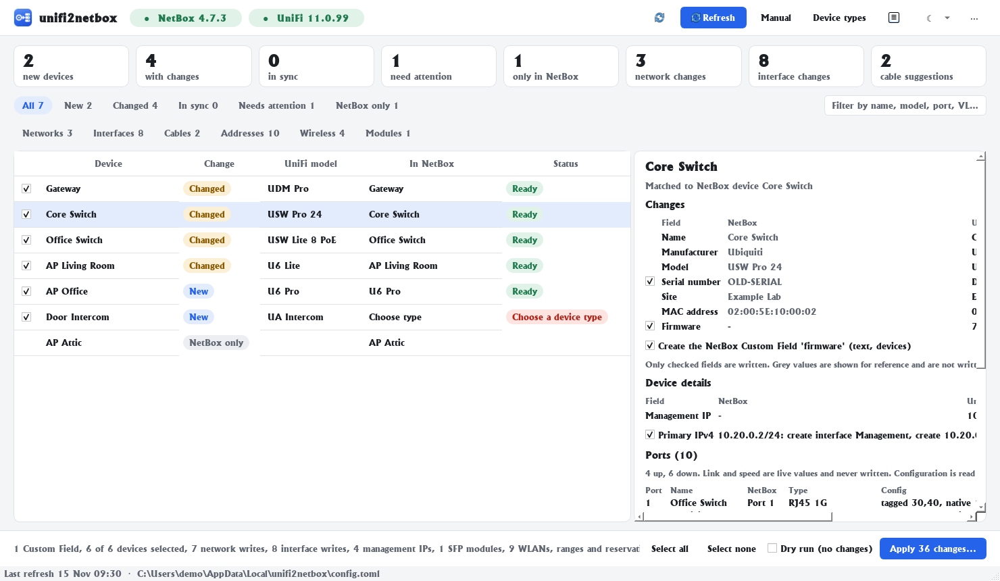
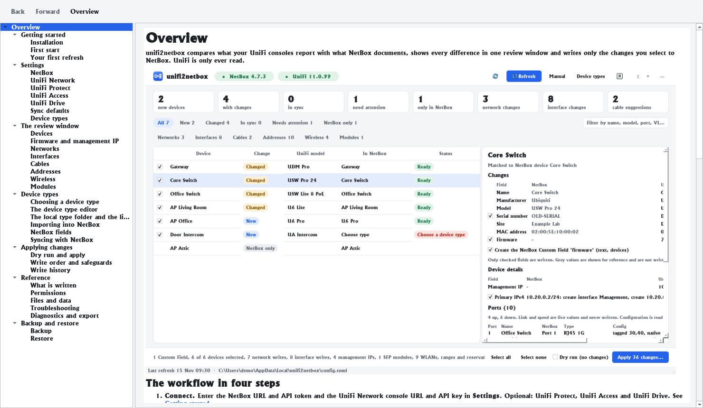

# Overview

unifi2netbox compares what your UniFi consoles report with what NetBox
documents, shows every difference in one review window and writes only the
changes you select to NetBox. UniFi is only ever read.

## The workflow in four steps

1. **Connect.** Enter the NetBox URL and API token and the UniFi Network
   console URL and API key in **Settings**. Optional: UniFi Protect, UniFi
   Access and UniFi Drive. See [Getting started](01-getting-started/index.md).
2. **Refresh.** **Refresh** (F5) reads both inventories and compares them.
   Nothing is written. See [Your first refresh](01-getting-started/03-first-refresh.md).
3. **Review.** Check new and changed devices, networks, interfaces, cables,
   addresses, wireless LANs and modules. Every change has a checkbox. See
   [Reviewing changes](03-review/index.md).
4. **Apply.** **Apply N changes** asks once and writes the selected changes;
   **Dry run** simulates them first. See [Applying changes](05-applying/index.md).

## What the app brings into NetBox

| UniFi | NetBox |
| --- | --- |
| Gateways, switches, access points (plus Protect, Access, UNAS hardware) | Devices with name, serial, site, device type, role and status |
| Models that NetBox does not know | Device types from your local folder or the devicetype-library, or written in the editor |
| Firmware version | Custom Field `firmware` on the device |
| Management IP | Primary IPv4 on a `Management` interface |
| Networks (VLANs and subnets) | VLAN group `UniFi <site>`, VLANs and prefixes |
| Port configuration | Interface mode, VLANs, description, fixed speed and duplex, PoE |
| Uplinks and LLDP neighbors | Cables between interfaces |
| SFP modules, UNAS drives | Inventory items |
| Wireless networks | Wireless LANs (never the passphrase) |
| DHCP pools and fixed client IPs | IP ranges and reserved IP addresses |

[What is written](06-reference/01-what-is-written.md) lists every field.

## Safety rules the app always follows

- **UniFi is never written.** All UniFi requests are read-only.
- **Nothing is deleted.** Devices that exist only in NetBox are shown for
  your review; you delete them yourself if needed.
- **Only checked changes are written,** after one confirmation.
- **Before writing**, UniFi and NetBox are read again; anything that changed
  since the preview is skipped instead of overwritten.
- **After writing**, every change is read back from NetBox and marked
  *Verified*, *Mismatch* or *Not verified*. Every run is saved in the
  [write history](05-applying/03-write-history.md).
- **Missing UniFi values never clear NetBox values,** and existing NetBox
  data that differs in a sensitive way (another primary IP, another VLAN on a
  prefix) is reported as a conflict instead of being overwritten.
- **One Custom Field only:** the app creates the Custom Field `firmware`, and
  only as a visible, selectable step. Device types are created only from a
  definition you chose, also as a visible step; manufacturers, owners, tags,
  platforms and inventory item roles only from a confirmed **New...**
  dialog; sites and roles only by a restore.

## Where to go next

- New here: [Installation](01-getting-started/01-installation.md), then
  [First start](01-getting-started/02-first-start.md).
- Settings for each service: [Settings](02-settings/index.md).
- A tour of the window: [The review window](03-review/index.md).
- A model is missing in NetBox: [Device types](04-device-types/index.md).
- Save or restore a whole NetBox: [Backup and restore](07-backup-restore/index.md).
- Something does not work: [Troubleshooting](06-reference/04-troubleshooting.md).

Open this manual at any time with **Manual** in the header or **F1**. The
tree on the left lists all chapters and pages; links between pages, **Back**,
**Forward** and **Overview** work like in a browser.

